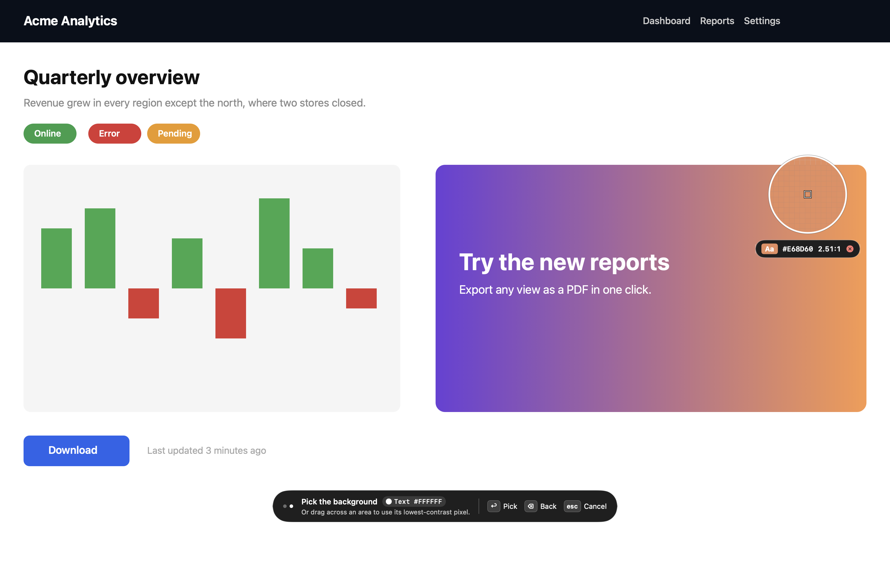
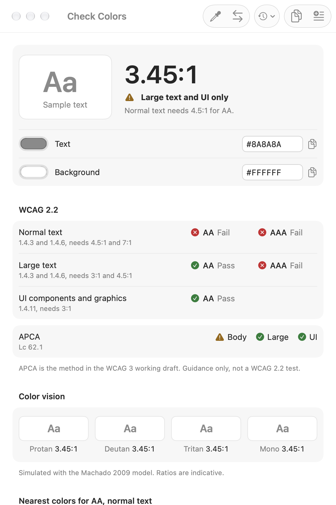
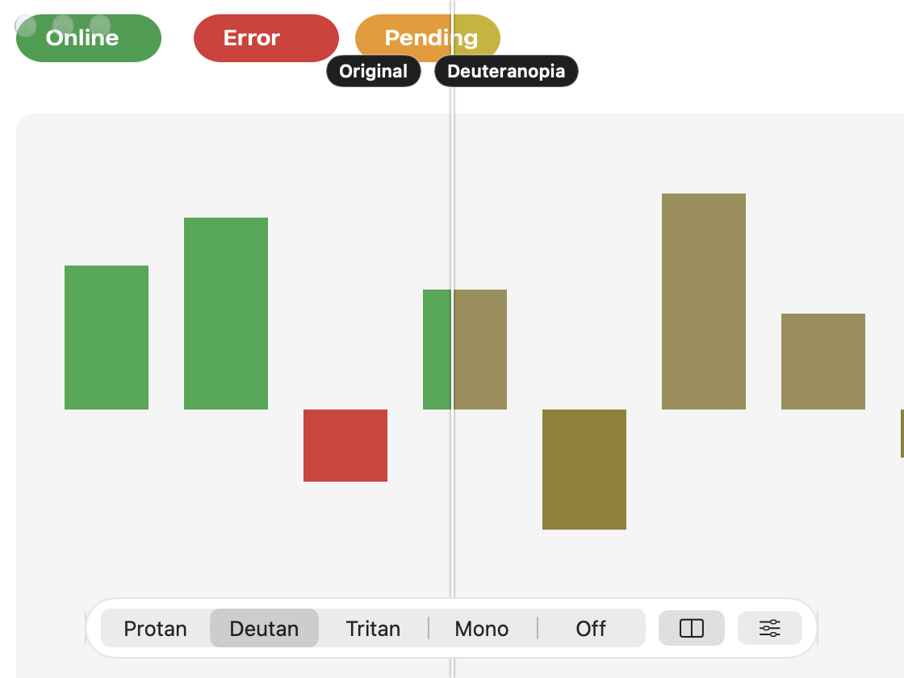

# Accessibility Build for Mac

A free menu-bar app from [accessibility.build](https://accessibility.build/desktop)
for checking accessibility anywhere on your screen.

- **Contrast picker.** Freeze the screen, pick text and background colors with
  a magnified pixel loupe (mouse or keyboard), and get WCAG 2.2 verdicts for
  normal text, large text and UI components, the APCA Lc value, the nearest
  passing colors, and the pair as four color-vision deficiencies may see it.
  Drag across a gradient or photo to use its lowest-contrast pixel.
- **Color-vision lens.** A floating lens that shows what is beneath it as
  protanopia, deuteranopia, tritanopia or achromatopsia, with severity, blur
  and contrast-loss filters and a split before and after view.
- **Quick capture.** Region, front window or whole display, optionally after a
  three-second delay for hover states and menus; copied to the clipboard and
  savable as PNG.
- **Session log.** Every pick and capture, exported as a Markdown summary.

Everything runs on the Mac. See [docs/PRIVACY.md](docs/PRIVACY.md).

Requires macOS 14 or later, Apple Silicon or Intel.



| Check Colors | Color-vision lens |
|---|---|
|  |  |

## Building

```sh
brew install xcodegen
scripts/build.sh            # Debug build, signed with the Developer ID certificate
(cd Packages/ColorCore && swift test)
(cd Packages/AuditCore && swift test)
```

The Xcode project is generated from `project.yml`; do not edit the
`.xcodeproj` by hand.

| Code | Where |
|---|---|
| WCAG, APCA, color-vision and auto-fix maths (ported from the website, tested against its output) | `Packages/ColorCore` |
| Pixel geometry across displays, worst-case search, finding text, Markdown export | `Packages/AuditCore` |
| Menu, windows, overlay, lens, capture, settings | `App/` |

`scripts/fixtures-from-website.mjs` regenerates the parity fixtures from the
website's `lib/color` code. Run it whenever that code changes.

## Development notes

- Always pass `-packageAuthorizationProvider netrc` to `xcodebuild` (the
  scripts do). Without it SwiftPM looks up GitHub credentials in the keychain
  and a background build hangs on the prompt.
- `scripts/snapshots.sh` renders every window to PNG, light and dark, and
  audits each one's accessibility tree, with no permissions and no UI
  automation. It launches the Debug build with `open`, never directly from a
  terminal: a terminal-launched app inherits the terminal's Screen Recording
  grant and can start real captures.
  Offscreen rendering cannot draw Liquid Glass, so snapshots show the Reduce
  Transparency look. `ax-findings.txt` lists unnamed controls; controls that
  SwiftUI labels through its own layer still need a VoiceOver check.
- `-openWindows checker,log,settings,permission,lens` and
  `-activationPolicy regular` (Debug only) help UI tooling reach a menu-bar app.

Releases: [docs/RELEASING.md](docs/RELEASING.md) for the website download,
[docs/APP_STORE.md](docs/APP_STORE.md) for the Mac App Store build. Accessibility of the app
itself: [docs/ACCESSIBILITY.md](docs/ACCESSIBILITY.md). Plan and decisions:
[docs/PLAN.md](docs/PLAN.md).
